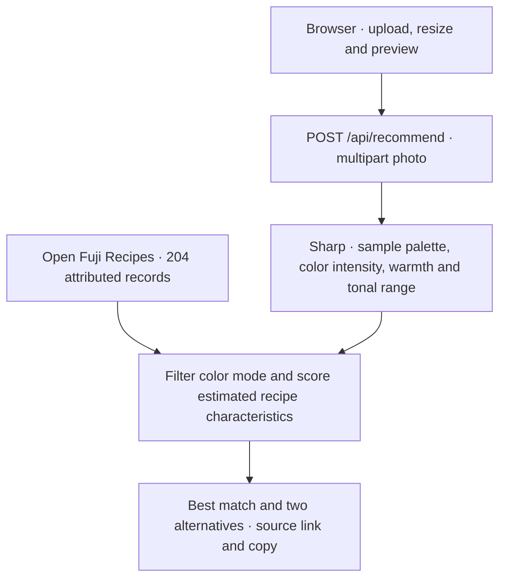

# filmish.

[Try the live demo](https://filmish-two.vercel.app/)

Upload a reference photo to find a Fujifilm recipe with similar color and tones. filmish shows the best match and two alternatives from Open Fuji Recipes, with the credited creator, original catalog entry, and listed sensor generation.

## Run locally

Requires Node.js 22 or newer and npm.

```sh
npm ci
npm run dev
```

Open [localhost:3000](http://localhost:3000). Upload a still JPEG, PNG or WebP up to 30 MB and 80 megapixels. The browser prepares a JPEG at up to 1,600 pixels on the longest side and automatically submits it. The prepared upload has a 4 MB server limit. The app processes photos in memory and requires no API key or database.

Run `npm run build` and `npm start` to serve a production build.

## Architecture



`lib/analysis.ts` measures the uploaded photo. `lib/open-fuji.ts` estimates each recipe’s color intensity, warmth, and contrast from the film simulation, white balance shift, and tone settings. These are heuristics. Matching does not measure grain or compare against example photos. Lighting, exposure, subject, and camera processing can all affect the result.

## Recipe data

The bundled catalog comes from [Open Fuji Recipes](https://openfujirecipes.com/). The [upstream snapshot](https://github.com/matthieurobin/open-fuji-recipes/blob/57e25194d41b109daaf1325fd086a7a232a732af/src/stores/data/recipes.js) contains 204 X-Trans III and IV records. Each result preserves the credited creator and links to its row in the snapshot. Recipe settings are presented as cataloged. Check your camera’s menus before applying them, especially when using a different sensor generation.

To regenerate the local snapshot, download the pinned source data module and run `node scripts/import-open-fuji.mjs path/to/recipes.js`. The importer parses the data without executing the module and keeps only recipe metadata and settings. When updating the snapshot, update the source revision in `lib/open-fuji.ts` so row links stay accurate.
