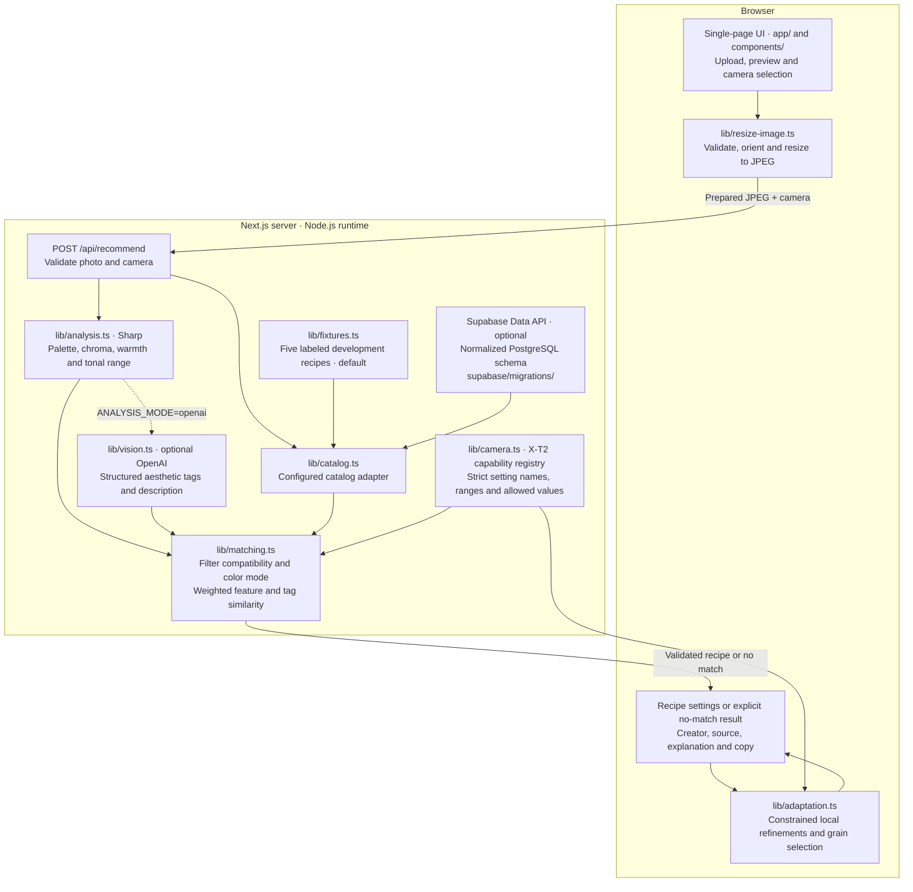

# filmish.

A single-page Fujifilm X-T2 recipe finder. Upload a reference, choose the camera, and get one compatible starting point from the selected catalog. Refine it in place and copy the settings for in-camera use.

## Run locally

Requires Node.js 22 or newer and npm.

```sh
npm ci
npm run dev
```

Open [localhost:3000](http://localhost:3000). Choose a still JPEG, PNG or WebP up to 30 MB and 80 megapixels. The browser preserves its orientation and aspect ratio, downsizes it to at most 1,600 pixels on its longest side, and encodes a JPEG before previewing or uploading it. Transparent areas are flattened onto white. The prepared upload is checked against a 4 MB server limit. The default configuration measures pixels from your actual photo and retrieves from five labeled development recipes with manually assigned descriptors. It needs no keys or database. Photos are processed in memory and the application does not store them.

Run `npm run build` to verify a production build. Use `npm start` to serve it.

## Architecture



Analysis and catalog modes are independent: pixel analysis and local fixtures work without credentials. Vision adds tags and a description to the measured features; it does not freely generate camera settings. Retrieval uses weighted differences and tag overlap, with no vector database. Refinements run in the browser and preserve the original settings and attribution. Photos are processed in memory, not persisted by the application.

`POST /api/recommend` accepts multipart fields `photo` and `camera` (currently `x-t2`). A successful response contains `analysis`, `catalog` and a validated `recipe`, or a null recipe with a reason. Invalid requests return 400 or 413. Configured upstream failures return 503. Refinement needs no network endpoint or repeat upload.

The X-T2 Dynamic Range settings have ISO prerequisites for DR200 and DR400, shown in results. Enter the white-balance shift when setting up or switching recipes that share a white-balance preset. The capability profile covers recipe controls in the [Fujifilm X-T2 image quality menu](https://fujifilm-dsc.com/en/manual/x-t2/menu_shooting/image_quality_setting/index.html) and [camera specifications](https://fujifilm-dsc.com/en-int/manual/x-t2/technical_notes/spec/index.html). Discrete Kelvin values are corroborated by [observed Fujifilm Kelvin selections](https://exiftool.org/forum/index.php?topic=10890.0). In-camera verification of the full compatibility matrix is still pending.

## Enable vision or a live catalog

Copy `.env.example` to `.env.local` and restart Next.js after editing it. The catalog and analysis modes can be configured independently.

- Set `ANALYSIS_MODE=openai` and supply `OPENAI_API_KEY`. The default model is `gpt-4.1-mini`. An override must support image input and Structured Outputs through the Responses API. When the user requests a recipe, the server sends a resized JPEG with its metadata removed and sets `store: false` on the API request. A failed vision request surfaces an error. [OpenAI image input](https://developers.openai.com/api/docs/guides/images-vision) and [Structured Outputs](https://developers.openai.com/api/docs/guides/structured-outputs)
- Set `RECIPE_CATALOG=supabase` and supply `SUPABASE_URL` and a server-only `SUPABASE_SECRET_KEY`. Apply the SQL migration to a Supabase PostgreSQL project, then populate the source, creator, recipe, X-T2 settings, feature profile and tag tables from authorized data. The migration seeds model and tag metadata only. The settings JSON follows `lib/camera.ts` and the feature profile follows `lib/recipe.ts`. The live catalog can be empty and never silently falls back to local fixtures. [Supabase API keys](https://supabase.com/docs/guides/getting-started/api-keys)
- For Vercel, use the Next.js preset, Node.js runtime and the same server-only environment variables. The 4 MB prepared-upload cap leaves room for multipart overhead while browser resizing accepts larger originals. Before enabling paid vision on a public deployment, configure request limits at the hosting layer. [Vercel Functions limits](https://vercel.com/docs/functions/limitations)

Live vision and Supabase connectivity require project credentials and have yet to be verified against live services.

## Open Fuji Recipes intake

The [project repository](https://github.com/matthieurobin/open-fuji-recipes) lists over 200 community recipes. Its [recipe module](https://github.com/matthieurobin/open-fuji-recipes/blob/master/src/stores/data/recipes.js) exports a JavaScript array with IDs, names, creator names, sensor generations, film simulations, shorthand settings and an optional image structure. The file credits a community spreadsheet and inspected records do not carry individual source URLs. Settings span generations and can include controls such as clarity and Color Chrome.

The repository listing shows no top-level license, and the reviewed material did not establish redistribution permission for recipes or images. Before adding an importer, establish the dataset's terms and the rights for each recipe and any image, resolve original creator and source links, then map the settings and validate each target model. Quarantine ambiguous values, provenance gaps and incompatible records. The development catalog is original to this project and has no third-party examples.

## Phases and uncertainties

1. **Pass 1.** Local vertical slice, optional provider adapters, strict compatibility, no-match behavior, deterministic refinement and a normalized database migration.
2. **Authorized catalog.** Confirm intake rights and attribution, write a source-specific importer, validate a live Supabase catalog, and add camera profiles from manuals and hardware checks as needed.
3. **Matching evaluation.** Collect authorized reference and SOOC pairs across different scenes and lighting. Tune feature weights and rejection thresholds against photographer judgments. Explore semantic embeddings and pgvector only if evaluation shows a meaningful improvement. Test-photo uploads can later reuse the image analysis interface as a separate input.

Pixel warmth can reflect the subject rather than lighting or white balance. Catalog profiles and the initial thresholds are heuristic. Exposure, illumination, subject and camera processing affect JPEG appearance, so the recommendation is a starting point for camera testing.
